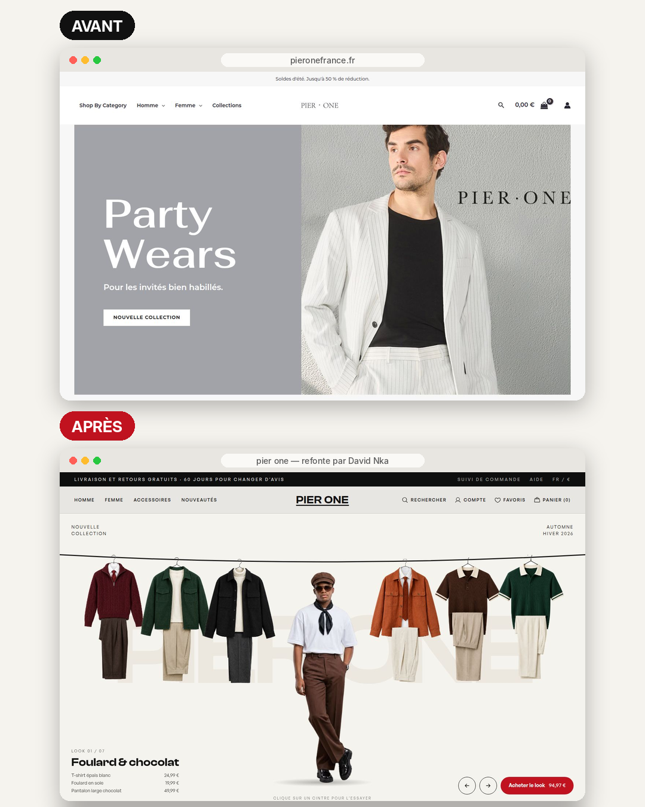
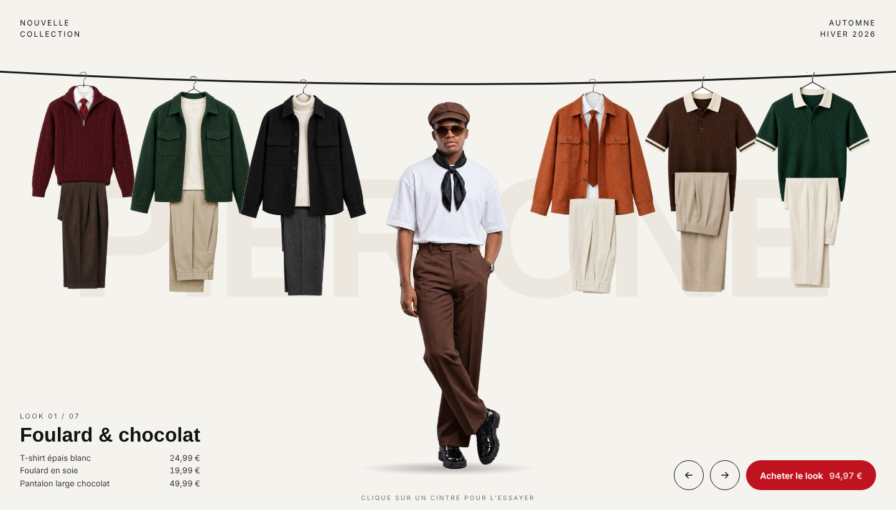
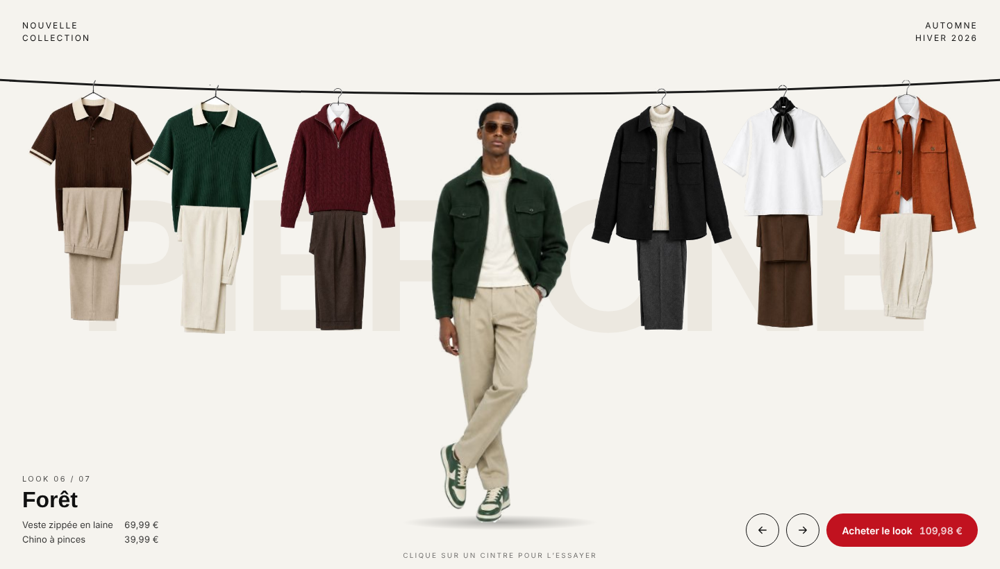
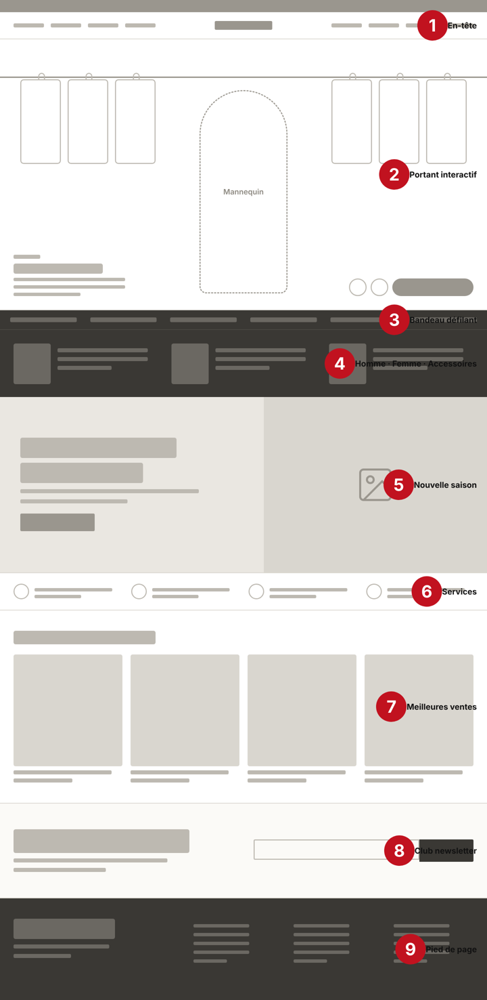
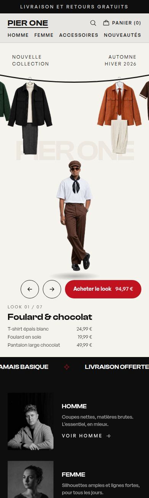

# Pier One — refonte

Concept de refonte du site [pieronefrance.fr](https://www.pieronefrance.fr), conçu et développé par **David Nka** (product designer, UX/UI et web designer).

> Projet personnel et non officiel, sans lien avec Pier One France.

**Site en ligne :** https://handsome-heptagon-711082.framer.app



## L'idée

Un portant de vêtements suspendu à une corde. Tu cliques sur un cintre : il part vers le mannequin, le mannequin porte le look, et tout le portant glisse. La tenue d'avant revient sur un cintre.

| Avant le clic | Après le clic |
|---|---|
|  |  |

## Le process

1. **Analyse du site actuel** : ce qui marche (logo, prix visibles, navigation claire) et ce qui coince (soldes d'été affichées en novembre, anglais et français mélangés, faux texte oublié, photos sans fil conducteur).
2. **Wireframes** : la structure de la page d'accueil avant les couleurs.
3. **Le portant** : une V1 en 3D, abandonnée, puis une version avec de vraies photos.
4. **Le site complet** dans Framer : accueil, Homme, Femme, Accessoires, fiche produit, panier, version mobile.



## Comment marche le portant

Le code est dans [`portant/src/PierOnePortant.jsx`](portant/src/PierOnePortant.jsx) (React + Framer Motion). La version utilisée dans Framer, avec ses réglages dans le panneau, est dans [`framer/PierOnePortant.tsx`](framer/PierOnePortant.tsx).

- **Chaque cintre connaît sa place** par rapport au look porté, de -3 (à gauche) à +3 (à droite). Un clic change le look porté, donc toutes les places changent d'un coup.
- **Un ressort, pas une durée** : les cintres se déplacent avec un ressort Framer Motion (`stiffness: 120`, `damping: 20`). Ils accélèrent puis freinent en douceur.
- **Le mannequin** : une photo par look, en fondu, avec 0,2 seconde de décalage pendant que le cintre cliqué grossit et s'efface.
- **Le détourage** : les photos sont sur fond blanc, et le fond est retiré dans le navigateur au chargement (remplissage depuis les bords et contour adouci), sans détourer chaque photo à la main.
- **Mobile** : sous 760 px de large, les cintres restent sur la corde en haut et le mannequin passe en dessous.

Photos : la photo du look 1 est une vraie photo du modèle ; les autres tenues portées et les cintres sont générés par IA dans la même pose.

## Lancer la démo

```bash
cd portant
npm install
npm run dev
```

## Contenu du repo

```
portant/     démo React du portant (Vite)
framer/      le composant de code tel qu'il est dans Framer
linkedin/    les 4 posts LinkedIn et leurs visuels (vidéos, carrousel PDF)
docs/        captures utilisées dans ce README
```



---

Conçu et développé par **David Nka (DN)** · [github.com/davidnkagodwill](https://github.com/davidnkagodwill)
